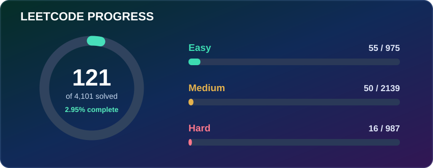
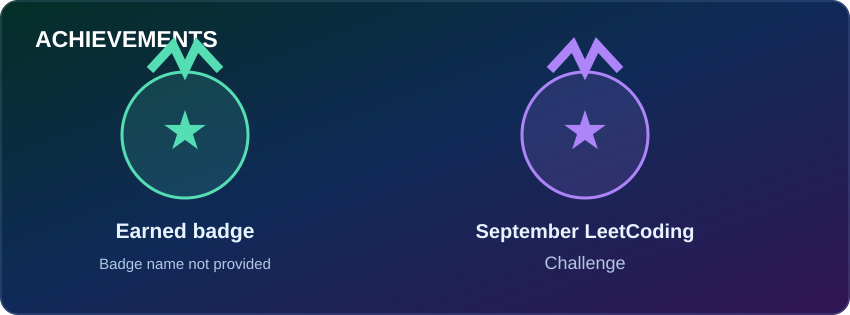

---

## About Me

I'm a Computer Science student focused on **Machine Learning, Computer Vision, backend development, and Android application development**. I enjoy building practical projects that connect software, data, and real-world problem solving.

- Working with Python, machine learning workflows, and computer vision.
- Exploring backend development, REST APIs, databases, and server-side systems.
- Developing Android applications with Kotlin.
- Interested in AI agents, automation, and applied AI.
- Always learning by building, testing, and improving projects.

---

## Tech Stack

### Languages

  

### AI / ML & Computer Vision

  
  
  
  
  

### Backend, Web & Mobile

  

### Databases & Tools

  

---

---

## LeetCode Progress

### Achievements

[View my LeetCode profile](https://leetcode.com/u/HarshvardhanPandhare/)

LeetCode numbers are a snapshot from November 7, 2026, not live statistics. The badge illustrations are custom designs, not official LeetCode badge artwork.

---

## Currently Exploring

- Applied Machine Learning and model evaluation
- Computer Vision and real-time detection
- Agentic AI and retrieval-augmented generation (RAG)
- Backend architecture, APIs, and databases
- Android development with Kotlin

---
## Featured Projects

| Project | What it does | Tech |
|---|---|---|
| [Spam Detection using Machine Learning](https://github.com/HarshuPandhare/SpamDetection_Using_MachineLearning) | Machine-learning based spam classification project. | Python, ML |
| [Agentic AI](https://github.com/HarshuPandhare/Agentic-AI) | Experiments and development around agent-based AI workflows. | Python, AI |
| [YOLOv8 OpenCV Computer Vision System](https://github.com/HarshuPandhare/yolov8-opencv-computer-vision-system) | Computer-vision system built with YOLOv8 and OpenCV. | Python, YOLOv8, OpenCV |
| [Computer Vision Security System](https://github.com/HarshuPandhare/Computer-Vision-Security-System) | Computer-vision focused security project. | Python, Computer Vision |
| [SECURECAM](https://github.com/HarshuPandhare/SECURECAM) | Security-oriented project with a web interface. | HTML |
| [MahaFPO Registration](https://github.com/HarshuPandhare/MahaFPO-registration) | Registration-focused web application. | TypeScript |

---

## Connect

  

  Building consistently. Learning continuously.

